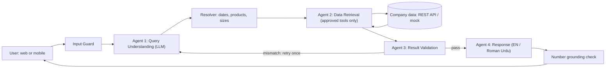

<div align="center">


# Briha AI Chatbot

**A multi-agent analytics chatbot that answers business questions from live company data, in English or Roman Urdu, with every number verified against its source.**


</div>

> ⚡ **BRIHA: The Genesis of AGI.** This is a **flagship** of the [BRIHA AI World](https://github.com/asad110abbas), built by **Syed Asad Abbas**.

---

## Overview

Managers shouldn't need a BI analyst to answer *"how many sheets did we cut today and how much did we sell?"*.
Briha lets them ask in plain words, including Roman Urdu like *"aaj kitne papers kate aur kitne bike?"*, and replies
in seconds with numbers pulled from the company's own systems.

The design goal was **trustworthy answers, not just fluent ones**:

- The LLM **never writes SQL**. It picks an *approved, read-only* tool and its parameters. The data layer is human-reviewed.
- A **validation agent** checks that the fetched rows actually answer the question, and retries once if they don't.
- A **grounding check** confirms every number in the final answer exists in the fetched data. Otherwise the answer is regenerated.
- It **only reads**. Business data is never modified.

## Architecture



| Stage | Type | Responsibility |
|---|---|---|
| Input Guard | Code | Auth, rate limiting, length limits, abuse filtering |
| Query Understanding | LLM | Detects language and intent, extracts dates, product type, size, unit, and picks tool(s) |
| Resolver | Code | Turns "aaj / kal / pichle hafte" into exact dates, and fuzzy-matches product names and sizes to master data |
| Data Retrieval | Code | Calls the selected endpoint with validated parameters through a pluggable `DataSource` interface |
| Result Validation | Code + LLM judge | Verifies dates, filters and metric match the question, retrying or answering honestly when they don't |
| Response | LLM | Writes a short answer in the user's language and shows the filters it applied |
| Grounding | Code | Rejects any number that isn't in the source data |

## Features

- 💬 **Bilingual chat** in English and Roman Urdu, remembering the user's reply language
- 🧠 **Multi-agent pipeline** with retries, a validation guard and numeric grounding
- 🔌 **Swappable data sources**: `mock` (deterministic demo data with fault injection) and `rest` (YAML-configured APIs)
- 🤖 **Multiple LLM backends**: OpenAI GPT-5, Google Gemini, or a fully **offline demo mode** that needs no API key
- ⚡ **Streaming answers** over Server-Sent Events, with a typing effect
- 🔐 **Auth and admin**: Argon2 password hashing, server-side sessions, rate limits, user management, audit log
- 🗂️ **Conversation history**: rename, delete, rate answers, and per-user ownership enforcement
- 📱 **Responsive UI**: React 19 + Tailwind, intro walkthrough for new users, glass-style ocean-blue theme
- 🐳 **Production-ready deployment**: Docker Compose (Nginx + FastAPI + PostgreSQL), Alembic migrations, HTTPS config

## Tech stack

| Layer | Technologies |
|---|---|
| Backend | Python 3.12, FastAPI, SQLAlchemy 2 (async), Alembic, Pydantic v2, structlog, APScheduler |
| AI | OpenAI API (GPT-5), Google Gemini, prompt-engineered agents, RapidFuzz entity resolution |
| Frontend | React 19, TypeScript, Vite, Tailwind CSS v4, TanStack Query |
| Data | PostgreSQL 16, pluggable REST adapter (httpx) |
| Quality | pytest + pytest-asyncio (78 tests), respx HTTP mocking, Vitest, Ruff |
| Ops | Docker, Docker Compose, Nginx, `uv` |

## Quick start

**Try it with zero API keys** (offline demo LLM + mock data):

```bash
git clone https://github.com/asad110abbas/briha-ai-chatbot.git
cd briha-ai-chatbot
cp .env.example .env            # set LLM_MODE=offline_demo, DATASOURCE_MODE=mock, and pick passwords
cp data_apis.example.yaml data_apis.yaml
docker compose -p briha -f docker-compose.local.yml up -d --build
# open http://localhost:8080 and sign in with ADMIN_USERNAME / ADMIN_PASSWORD from .env
```

**Local development:**

```bash
# backend
cd backend
uv sync
uv run alembic upgrade head
uv run uvicorn app.main:app --reload

# frontend (new terminal)
cd frontend
npm install
npm run dev                     # http://localhost:5173
```

**Run the tests:**

```bash
cd backend && uv run pytest
cd frontend && npm test
```

To use a real LLM, set `LLM_MODE=openai` (or `gemini`) and add the key in `.env`.
To connect real data, copy `data_apis.example.yaml` to `data_apis.yaml`, point it at your endpoints, and set `DATASOURCE_MODE=rest`.

## Project structure

```
backend/
  app/
    api/            REST + SSE endpoints (auth, chat, conversations, admin)
    auth/           sessions, password hashing, rate limiting
    datasources/    DataSource interface + mock and REST adapters
    llm/            LLM client and agent prompts
    pipeline/       orchestrator, agents, resolvers, grounding
    db/             models, seed data
  migrations/       Alembic migrations
  tests/            unit + API tests
frontend/           React + TypeScript SPA
deploy/             Nginx config, web Dockerfile, VM deployment guide
```

## Example questions

| Language | Question |
|---|---|
| English | "How much art card did we sell last week?" |
| Roman Urdu | "aaj kitne papers kate aur kitne bike?" |
| English | "What's the current stock of 23x36 offset 80 gsm?" |

> The bundled mock data is synthetic. It's generated deterministically for demos and tests and doesn't represent any real business.

## Deployment

| Target | How |
|---|---|
|  **Vercel** | Deployed to Vercel for cloud access (`vercel.json` routes the SPA and API) |
|  **Docker Compose** | `docker compose up -d --build` runs Nginx (HTTPS + frontend) → FastAPI → PostgreSQL on any Linux VM |
|  **On-prem VM** | Step-by-step guide in [deploy/README.md](deploy/README.md): TLS, backups, go-live checklist |

## License

[MIT](LICENSE)
